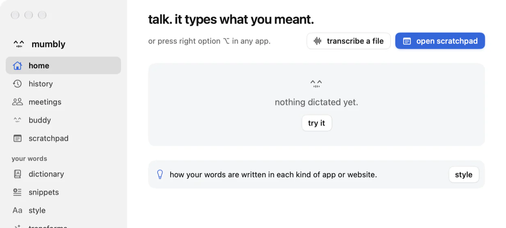
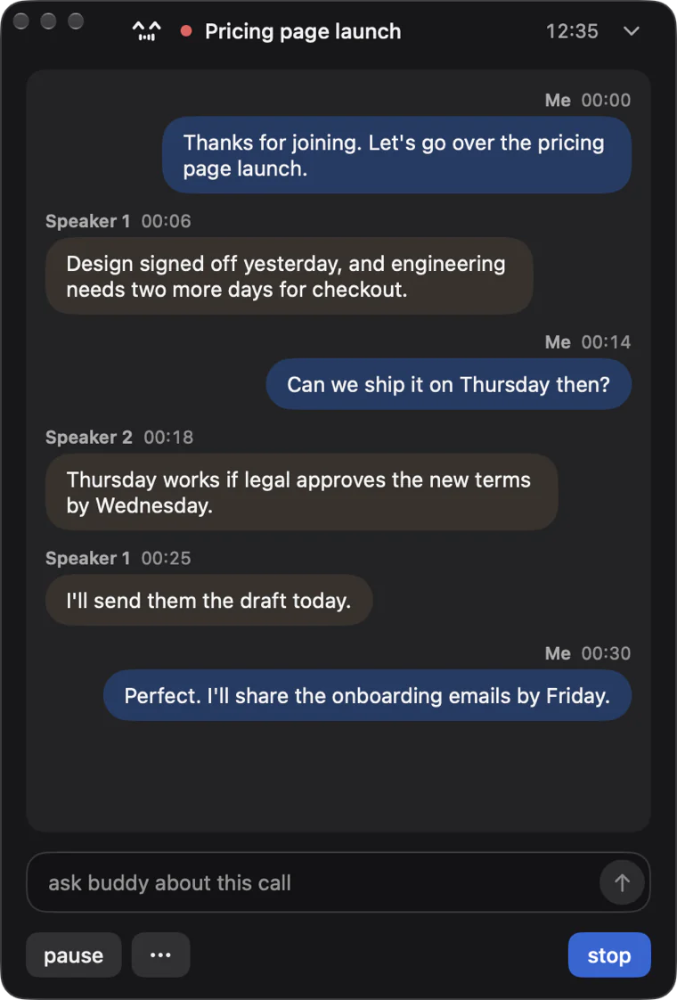
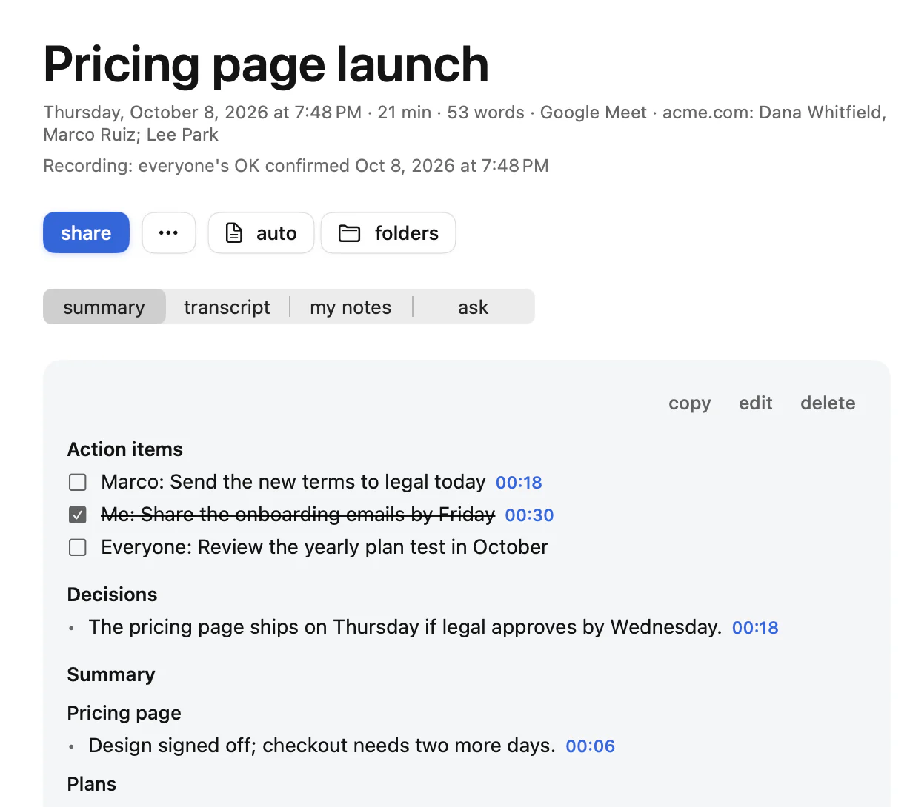

# mumbly

talk. it types what you meant.

a free dictation app for the mac. press a key, talk, and it types where your cursor is, cleaned up as you speak. the speech and cleanup models run on your mac, so what you say stays on it.

## get it

needs a mac with apple silicon and macos 26 or later.

**download.** [mumbly.zip](https://github.com/lvecchi500-art/mumbly/releases/latest/download/mumbly.zip), open it, and move the app to applications. macos asks you to allow it once in system settings, privacy & security.

**terminal.** no warning, and it opens the app for you:

```
curl -fsSL https://heymumbly.com/install | sh
```

**homebrew.**

```
brew install --cask lvecchi500-art/mumbly/mumbly
```

after the first install, mumbly updates itself. the app file is still called `LocalDictation.app`, so permissions and updates carry over from the versions before the rename.

 



## the promise

mumbly is free. Everything it does for you today stays free: no account, no ads, and no paywall on any feature you have used. If we ever add something paid, it will be new and optional, and everything that was free stays free.

## privacy

your audio and your words stay on your mac: the models run there, and the app needs no account.

## not notarized yet

this build is signed with the project's own certificate, not an apple developer id, which is why the zip asks you to allow it once. the terminal and homebrew installs check that the app is signed by that certificate and refuse anything else. updates are signed too.

## what macos will ask

microphone, to hear you only while you hold or toggle the shortcut. accessibility, to type where your cursor is. the rest (screen and system audio, calendar, reminders, contacts, notifications) only when you use the feature that needs it.

## remove it

in the app: settings, general, uninstall. with the app already gone:

```
curl -fsSL https://heymumbly.com/uninstall | sh
```

that keeps your history, notes and meetings. add `-s -- --all` after `sh` to delete those too (it asks first, and `--dry-run` only lists what it would remove). with homebrew: `brew uninstall --cask mumbly`.

## help

[heymumbly.com](https://heymumbly.com) · support@heymumbly.com · open an issue here (issues are public: nothing private in one) · [what changed](https://heymumbly.com/changelog.html)

mumbly was called local dictation until version 0.7.12, and this repository was called local-dictation-releases; github sends the old address here.

the binaries are free to use. all rights reserved: no licence to copy, modify or redistribute them is granted. the software and models mumbly is built on keep their own licences, listed in the app (settings, privacy, acknowledgements). to report a security problem, email support@heymumbly.com, not a public issue.
